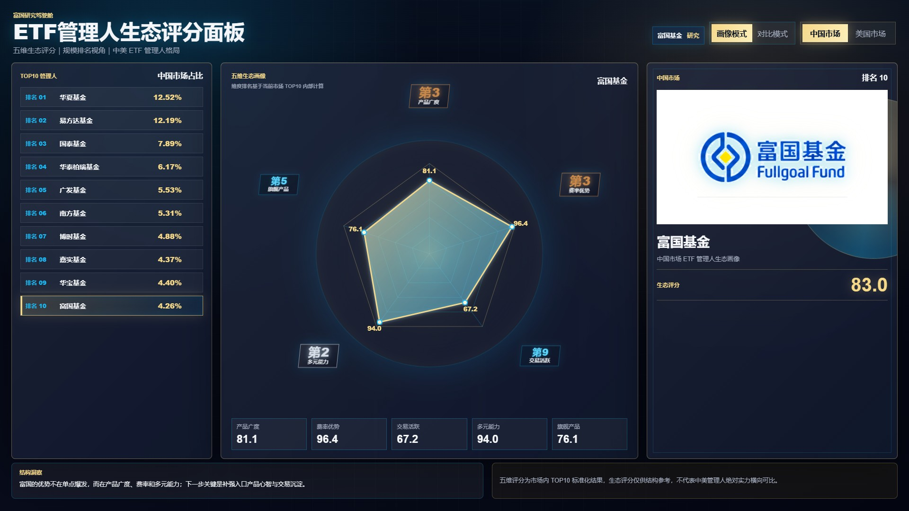
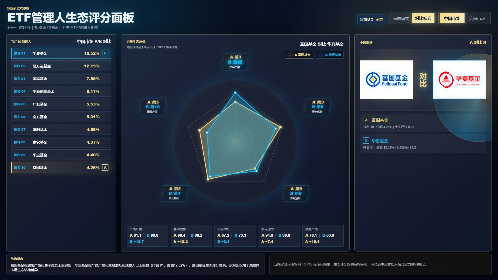
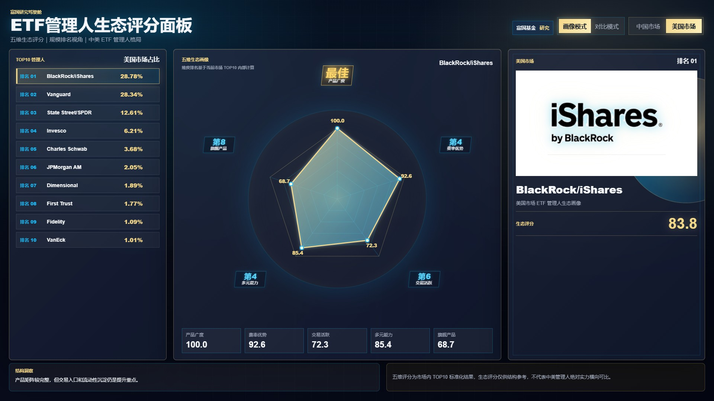
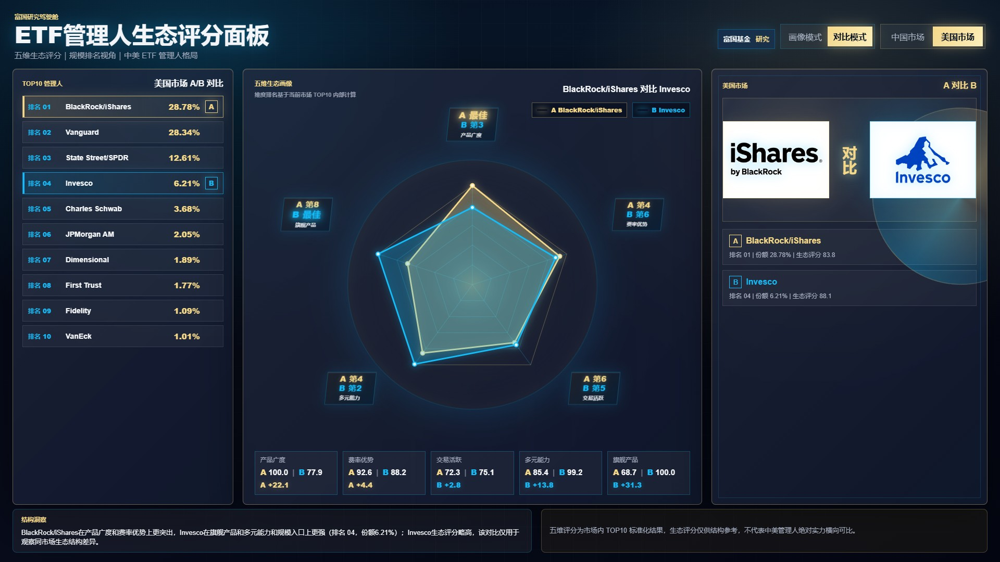

# FullGoal-QUANT · ETF 管理人生态评分 Dashboard

把中美 ETF 管理人的规模排名与五维生态评分，组织成可交互的研究看板。适合快速观察一家管理人的结构优势，或比较同一市场内两家公司的差异。

**[打开在线演示](https://aequanimis.github.io/FullGoal-QUANT/)** · [页面源码](7.9%20dashboard/) · [研究项目说明](#研究项目与公开范围)

## 业务问题与产品功能

只看规模排名，难以解释管理人的产品结构。这个 Dashboard 将规模、生态评分、分维度排名和研究解读放在同一屏中，支持从公司画像进入双管理人对比。

| 能力 | 页面呈现 |
|---|---|
| 中美市场切换 | 分别展示各市场 TOP10 管理人的历史规模排名、市场占比与生态画像 |
| 五维生态评分 | 产品广度、费率优势、交易活跃、多元能力、旗舰产品 |
| 画像模式 | 单家管理人雷达图、维度排名、综合评分与结构洞察 |
| 对比模式 | 双管理人叠加雷达、A/B 差异、维度排名与品牌识别 |

中国市场双管理人对比

美国市场画像与对比

## 实现与本地使用

纯 HTML、CSS、JavaScript 与 SVG 雷达图；JSON 保存已生成的历史评分。没有后台服务或实时数据 API。市场、管理人和模式切换均在浏览器内完成，不需要安装依赖。

下载仓库后，打开 <code>7.9 dashboard/index.html</code> 即可体验；浏览器限制本地 JSON 读取时，页面使用源码内同版本数据兜底。在线演示从独立 <code>gh-pages</code> 静态分支提供，不部署研究资料目录。

## 数据与结果边界

- 展示版本源于 <code>b60cd90</code>，界面和评分数据保持原样。本次发布没有修改评分方法或研究结论。
- 数据是历史静态快照，页面不会自动更新；不能把它当作当前排名。评分在各市场 TOP10 内标准化，不用于中美绝对实力横向比较。
- 本项目展示研究与产品实现，不构成投资建议，也不宣称带来业务效率或投资收益提升。
- 管理人名称和既有标志用于识别页面中的研究对象，权利归各自权利人；本项目不代表任何机构官方发布或背书。

## 研究项目与公开范围

FullGoal-QUANT 原研究主题为境内外策略 ETF 发展情况及经验借鉴。原目录与 Git 历史保留；Pages 只部署原仓已公开 Dashboard 的 HTML、CSS、JS、JSON 和使用中的 Logo，以及必要静态站点标记，不包含原始研究文件、开发环境或个人介绍魔方。
